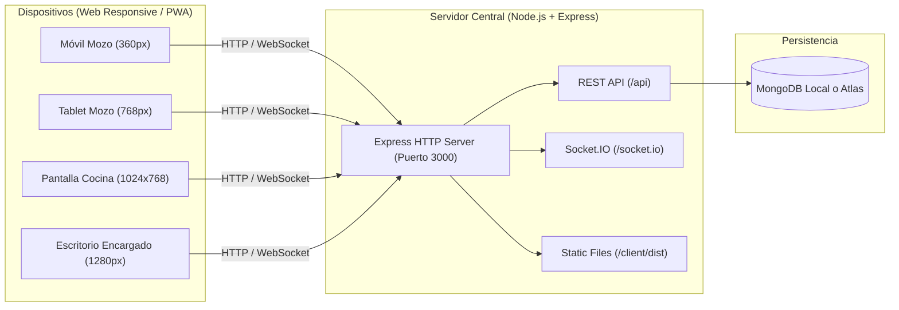

# Guía de Despliegue — Cevichería Lucy

Guía completa para la preparación, configuración, compilación y despliegue del sistema web responsive de pedidos y cocina en tiempo real para **Cevichería Lucy** (Spec `007-despliegue-web-responsive`).

---

## 0. Demo rápida sin MongoDB (solo desarrollo)

Para probar el sistema sin instalar MongoDB:

```bash
npm install
npm run dev:mock
```

Esto levanta:

- API en `http://localhost:3000` con una instancia **embebida en memoria** de MongoDB.
- Seed automático e idempotente (usuarios, mesas, menú del día publicado y turno abierto).
- Cliente Vite en `http://localhost:5173` con proxy de `/api` y `/socket.io`.

Datos locales: `server/.mongo-dev-data` (ignorado por git). Para reiniciar de cero,
detén el proceso y borra esa carpeta. **No usar `USE_EMBEDDED_MONGO` en producción.**

---

## 1. Arquitectura de Despliegue

El sistema está diseñado para operar bajo dos modos de despliegue principales:



### Modo A: Servicio Único (Recomendado para Producción y Demo)
- Un único proceso Node.js/Express sirve la API REST (`/api`), los canales WebSocket (`/socket.io`) y los archivos estáticos compilados de la SPA (`client/dist`).
- Las rutas del cliente (como `/mozo`, `/cocina`, `/admin`) utilizan un fallback SPA que retorna `index.html`, excluyendo `/api` y `/socket.io`.
- Ventajas: Un solo puerto y origen (simplifica CORS), sin dependencias de servidores web adicionales, ideal para despliegues locales o en un servidor central en el restaurante.

### Modo B: Frontend Separado (Opcional)
- El frontend compilado (`client/dist`) se aloja en un servidor estático independiente (Nginx, Vercel, S3/CloudFront).
- El backend Express opera únicamente como API REST y servidor Socket.IO.
- Requiere configurar `CORS_ORIGIN` en el backend y `VITE_API_URL` / `VITE_SOCKET_URL` apuntando a la URL del backend antes del build.

---

## 2. Variables de Entorno

Copia la plantilla `.env.example` a `.env`:

```bash
cp .env.example .env
```

### Tabla de Variables

| Variable | Tipo | Por defecto | Descripción |
|---|---|---|---|
| `NODE_ENV` | `enum` | `development` | Entorno (`development`, `production`, `test`). En `production` se activa el servicio estático. |
| `PORT` | `number` | `3000` | Puerto TCP en el que escucha el servidor Express y Socket.IO. |
| `MONGODB_URI` | `string` | *(obligatorio)* | Cadena de conexión a MongoDB (local o Atlas). |
| `JWT_SECRET` | `string` | *(obligatorio)* | Secreto criptográfico para firma de JWT. Cambiar obligatoriamente en producción. |
| `JWT_EXPIRES_IN` | `string` | `8h` | Tiempo de vida del token JWT (ej. `8h`, `12h`). |
| `CORS_ORIGIN` | `string` | `http://localhost:5173` | Orígenes permitidos para CORS REST y Socket.IO. Admite múltiples URLs separadas por coma. |
| `SERVE_STATIC` | `boolean` | `false` | Forzar servicio de `client/dist` aun cuando `NODE_ENV` sea distinto de `production`. |
| `VITE_API_URL` | `string` | `http://localhost:3000/api` | URL base de la API REST consumida por el frontend en tiempo de compilación. |
| `VITE_SOCKET_URL`| `string` | `http://localhost:3000` | URL base del servidor Socket.IO consumida por el frontend. |

> [!CRITICAL]
> **Reconstrucción obligatoria de frontend**: Las variables que comienzan por `VITE_*` son incrustadas directamente dentro del código JavaScript del cliente durante el proceso de build (`npm run build -w client`). Si cambias `VITE_API_URL` o `VITE_SOCKET_URL`, **debes reconstruir el cliente** para que los cambios surtan efecto.

---

## 3. Proceso de Compilación (Build)

El monorepo cuenta con scripts de compilación coordinados:

```bash
# 1. Instalar dependencias completas del monorepo
npm install

# 2. Compilar todo el proyecto (shared -> server -> client)
npm run build
```

Si deseas compilar individualmente cada workspace:
```bash
npm run build:shared    # Compila tipos TypeScript a /shared/dist
npm run build:server    # Compila TypeScript del servidor a /server/dist
npm run build:client    # Compila SPA con Vite y genera PWA en /client/dist
```

El build genera:
- `client/dist/`: HTML, bundle JS/CSS optimizado con gzip, service worker (`sw.js`), manifiesto (`manifest.webmanifest`) e iconos PWA.
- `server/dist/`: JavaScript ejecutable por Node.js.

---

## 4. Base de Datos (MongoDB)

### 4.1. Conexión Local vs Atlas

- **MongoDB Local**:
  ```dotenv
  MONGODB_URI=mongodb://127.0.0.1:27017/cevicheria_lucy
  ```
- **MongoDB Atlas**:
  ```dotenv
  MONGODB_URI=mongodb+srv://<usuario>:<password>@cluster0.abcde.mongodb.net/cevicheria_lucy?retryWrites=true&w=majority
  ```
  *(Asegúrate de agregar la IP del servidor o `0.0.0.0/0` en el Network Access de MongoDB Atlas)*.

### 4.2. Siembra Inicial de Datos (Seed Idempotente)

El proyecto incluye un script de inicialización con usuarios demo, mesas (10 mesas), categorías y platos con raciones:

```bash
npm run seed
# o específicamente en el workspace server:
npm run seed -w server
```

El seed es **completamente idempotente**: si se ejecuta múltiples veces no genera duplicados de usuarios, mesas ni platos.

### 4.3. Credenciales Demo Sembradas

| Rol | Usuario | Contraseña | Vista Inicial |
|---|---|---|---|
| `ENCARGADO` | `encargado1` | `encargado123` | Panel de Control / Menú / Cierre de Turno |
| `MOZO` | `mozo1` | `mozo123` | Selector de Mesas / Toma de Pedidos |
| `MOZO` | `mozo2` | `mozo223` | Selector de Mesas / Toma de Pedidos |
| `COCINERO` | `cocinero1` | `cocina123` | Tablero de Cocina FIFO |

### 4.4. Respaldo y Restauración (`mongodump` / `mongorestore`)

Para realizar respaldos de la base de datos operativa:

```bash
# Generar respaldo de la base de datos
mongodump --uri="mongodb://127.0.0.1:27017/cevicheria_lucy" --out=./backup/$(date +%Y%m%d_%H%M%S)

# Restaurar respaldo (reemplazando colecciones existentes)
mongorestore --uri="mongodb://127.0.0.1:27017/cevicheria_lucy" --drop ./backup/<nombre_carpeta>/cevicheria_lucy
```

### 4.5. Reset Seguro para Demostraciones

Si se requiere volver al estado inicial limpio para una demostración:
```bash
# 1. Limpiar o borrar la base de datos en MongoDB
mongosh "mongodb://127.0.0.1:27017/cevicheria_lucy" --eval "db.dropDatabase()"

# 2. Volver a ejecutar el seed
npm run seed
```

---

## 5. Ejecución del Sistema

### 5.1. Ejecución Local en Modo Servicio Único (Producción)

```bash
# Asegurar build completo
npm run build

# Iniciar servidor Express en modo producción
NODE_ENV=production npm run start -w server
```
El sistema estará disponible íntegramente en:
- Web: `http://localhost:3000`
- API REST: `http://localhost:3000/api`
- Salud del sistema: `http://localhost:3000/api/health`

### 5.2. Ejecución en Red Local (LAN) para Tablets y Móviles

Para utilizar tablets de mozos y pantallas de cocina conectadas a la misma red WiFi del restaurante:

1. **Obtener la IP local del servidor**:
   - En Windows: `ipconfig` (ej. `192.168.1.50`).
   - En Linux/macOS: `ip a` o `ifconfig`.

2. **Configurar `.env` para la IP de la LAN**:
   ```dotenv
   NODE_ENV=production
   PORT=3000
   CORS_ORIGIN=http://192.168.1.50:3000,http://localhost:3000
   VITE_API_URL=http://192.168.1.50:3000/api
   VITE_SOCKET_URL=http://192.168.1.50:3000
   ```

3. **Reconstruir el frontend** para aplicar la IP:
   ```bash
   npm run build:client
   ```

4. **Permitir el puerto en el Firewall del sistema operativo**:
   - En Windows: Abrir el puerto TCP 3000 en el Firewall de Windows Defender para redes privadas.

5. **Iniciar el servidor**:
   ```bash
   NODE_ENV=production npm run start -w server
   ```

6. **Acceder desde los dispositivos**:
   - Tablet mozo: `http://192.168.1.50:3000/login`
   - Pantalla cocina: `http://192.168.1.50:3000/cocina`

---

## 6. PWA (Progressive Web App) e Instalación

La aplicación incorpora soporte PWA mediante `vite-plugin-pwa` con `registerType: 'autoUpdate'`:

- **Manifiesto Web (`manifest.webmanifest`)**:
  - Nombre: *Cevichería Lucy*
  - Nombre corto: *Lucy*
  - Color temático: `#0284c7` (Azul cevichería)
  - Modo de visualización: `standalone` (sin barras de navegador)
  - Iconos: `pwa-192x192.png` y `pwa-512x512.png` (con propósito `any` y `maskable`).
- **Service Worker (`sw.js`)**:
  - Precachea el shell de la aplicación (HTML, bundles JS/CSS, fuentes, iconos) para arranque instantáneo.
  - **No cachea datos operativos**: Las peticiones a `/api/*` y `/socket.io/*` siempre se comunican en vivo para garantizar la coherencia estricta de raciones y pedidos FIFO.

> [!NOTE]
> **Requisito de Instalación PWA**: Los navegadores modernos (Chrome, Edge, Safari) exigen un contexto seguro (**HTTPS** o **localhost**) para permitir la instalación en la pantalla de inicio ("Instalar aplicación"). En una red local bajo `http://192.168.1.x`, la aplicación funciona al 100% como web responsive, pero el prompt nativo de instalación puede no habilitarse a menos que se configure un proxy inverso con HTTPS (ej. Caddy, Nginx con mkcert o túnel Cloudflare).

---

## 7. Verificación Responsive y Objetivos Táctiles

La interfaz de usuario está optimizada para su uso táctil continuo en el restaurante:

### 7.1. Breakpoints Validados
- **360 px (Móvil Mozo en mano)**:
  - Diseño a una columna.
  - Sin scroll horizontal.
  - Selector de mesas y catálogo con tarjetas accesibles verticalmente.
- **768 px (Tablet Mozo)**:
  - Distribución fluida de mesas y panel de comanda lateral.
- **1024×768 px (Pantalla de Cocina)**:
  - Tablero de cocina estructurado en 2 columnas: columna izquierda con lista FIFO de pedidos pendientes, columna derecha con detalle del pedido activo y botón gigante "Marcar listo".
- **1280 px (Escritorio Encargado)**:
  - Panel administrativo completo para gestión de menú, raciones y resumen de cierre de turno.

### 7.2. Objetivos Táctiles (Touch Targets)
- Todos los elementos interactivos principales (botones de incremento de raciones, botones de selección de mesa, botón "Marcar listo", botón "Enviar a cocina") cuentan con un área táctil mínima de **≥ 44×44 px** para evitar toques accidentales en el entorno operativo.

---

## 8. Diagnóstico y Troubleshooting

### 8.1. Verificación de Salud (`/api/health`)
Para diagnosticar el estado del servidor y la base de datos:
```bash
curl -i http://localhost:3000/api/health
```
Respuesta esperada:
```json
{
  "status": "ok",
  "db": "connected",
  "uptimeSeconds": 120,
  "timestamp": "2026-11-19T04:00:00.000Z"
}
```
Si `db` figura como `"disconnected"`, el servidor está activo pero perdió conectividad con MongoDB.

### 8.2. Error de Variables de Entorno (`[ENV_ERROR]`)
Si falta alguna variable obligatoria (como `MONGODB_URI` o `JWT_SECRET`), el servidor rechaza el arranque de inmediato con un mensaje estructurado:
```text
[ENV_ERROR] Configuración de entorno inválida:
  - MONGODB_URI: MONGODB_URI is required to connect to MongoDB
```
**Solución**: Verificar que el archivo `.env` exista en la raíz del proyecto y contenga valores válidos.

### 8.3. Error de Conexión a MongoDB
Si la URI es válida pero el servidor de base de datos no está respondiendo:
```text
[ERROR] Fallo crítico al conectar con MongoDB: connect ECONNREFUSED 127.0.0.1:27017
[ERROR] Error fatal al iniciar el servidor: connect ECONNREFUSED 127.0.0.1:27017
```
**Solución**:
- Verificar que el servicio local de MongoDB esté iniciado (`mongod` o servicio del sistema).
- Si usas Atlas, verificar que tu IP actual esté autorizada en Network Access.

### 8.4. Errores de CORS
Si la consola del navegador muestra errores de tipo `Cross-Origin Request Blocked`:
- Verificar que la URL desde la que accede el navegador esté incluida en `CORS_ORIGIN` en el archivo `.env`.

---

## 9. Límites del Sistema y Fuera de Alcance

Conforme a la constitución y especificaciones del proyecto:
- **Sin APK nativa**: La aplicación opera exclusivamente como Web Responsive y Progressive Web App.
- **Sin pasarelas de pago ni facturación electrónica**: No calcula IGV, no emite comprobantes SUNAT ni procesa tarjetas. El registro de pagos es un registro operacional simple en efectivo/yape.
- **Sin modo offline de pedidos**: La consistencia de raciones agotadas y la cola FIFO de cocina requieren conexión activa con el servidor central.

---

## 10. Checklist de Validación de Despliegue

- [x] Compilación limpia de todos los paquetes (`npm run build`).
- [x] Verificación estricta de tipos TypeScript (`npm run typecheck`).
- [x] Linter sin advertencias ni errores (`npx eslint server/src`).
- [x] Validación de variables obligatorias con `[ENV_ERROR]`.
- [x] Servicio estático de SPA con exclusión de `/api` y `/socket.io`.
- [x] Manifiesto e iconos PWA generados en `client/dist`.
- [ ] *(Validación manual)* Prueba en Chrome Android en dispositivo físico.
- [ ] *(Validación manual)* Instalación PWA en pantalla de inicio (requiere HTTPS o localhost).
- [ ] *(Validación manual)* Prueba de `mongodump` y `mongorestore` en servidor de producción real.
